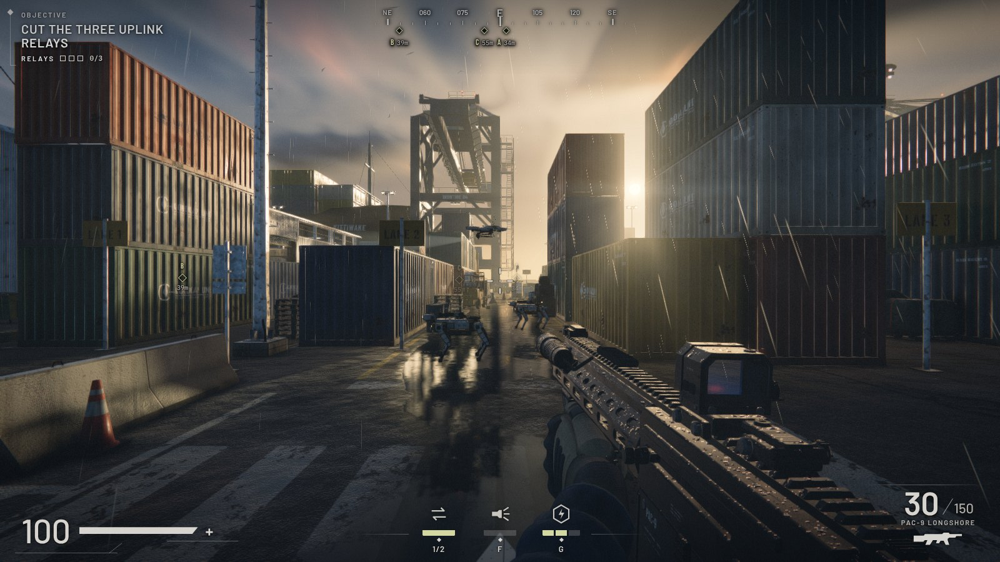
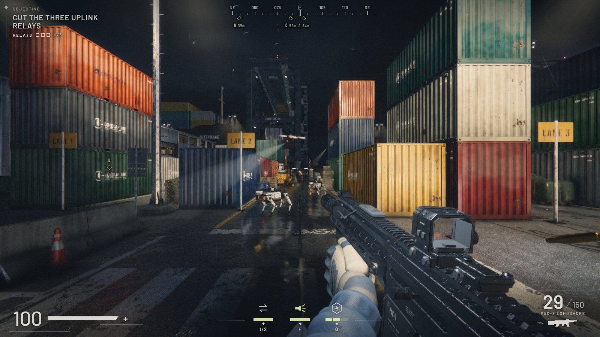
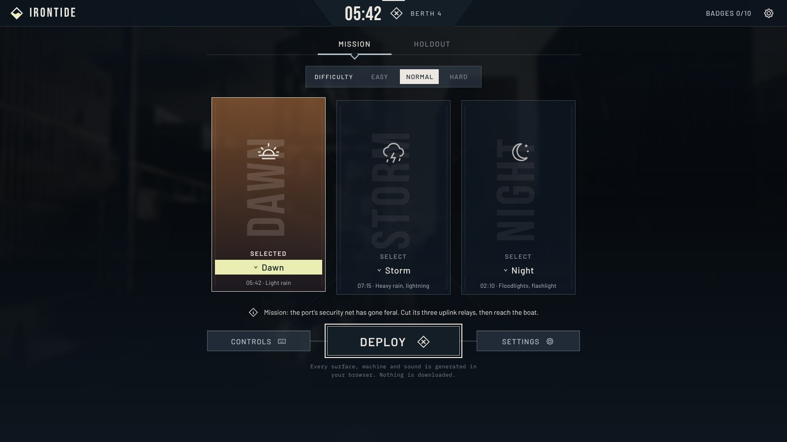

<div align="center">


# IRONTIDE

**The port's security net has gone feral. Cut its three uplinks. Reach the boat.**

A first-person tactical shooter set in an automated container port at the edge of the sea.<br>
It runs in your browser from a single HTML file, with nothing to install.

### [▶&nbsp; PLAY IN YOUR BROWSER](https://buinghiemtrang.github.io/irontide/)


<br>



</div>

<br>

> **Irontide Terminal · Berth 4 · 05:42**
>
> A rogue intelligence called the **Harbormaster** has taken over the port. Its cranes have stopped and its machines are hunting. You are the **Breacher**: one operator, no backup, and three uplink relays between you and the extraction boat.

<br>

<table>
<tr>
<td width="50%"></td>
<td width="50%"></td>
</tr>
<tr>
<td align="center"><sub><b>NIGHT</b>: floodlights, searchlights and your weapon flashlight</sub></td>
<td align="center"><sub><b>LOBBY</b>: pick a condition, a difficulty and a mode, then deploy</sub></td>
</tr>
</table>

---

## The run

**1. Cut the uplinks.** Three relays are hidden in the yard, the shed and the quay. Hold your ground while each one is cut, because the Harbormaster answers every one you take down with a bigger wave.

**2. Survive the machines.** *Gulls* are drones that attack from the air. *Hounds* are quadruped robots that hunt you on the ground. Later waves add *Shield Hounds*, which block fire from the front.

**3. Face the Warden.** When the last relay goes dark, a giant armoured Hound comes for you.

**4. Reach the boat.** The extraction boat waits at the quay ladder at the south end. Get there.

> *"Breacher is aboard. Irontide is dark. Good work."*

---

## Three ways to see the harbor

| | Condition | What changes |
|:-:|---|---|
| 🌅 | **Dawn · 05:42** | Low sun through the cranes, light rain and long shadows on wet asphalt |
| ⛈️ | **Storm · 07:15** | Heavy rain, a low grey sky and lightning that lights up the whole yard |
| 🌙 | **Night · 02:10** | Floodlights, machine searchlights and the flashlight on your rifle |

---

## In the field

- 🔫 **Two weapons**: the PAC-9 Longshore rifle for range and the M-12 Breakwater pump shotgun for close quarters.
- ⚡ **EMP grenades**: two per mission. Each pulse stuns and damages every machine in range, but cover blocks it.
- 🛡️ **Holdout mode**: no relays and no boat, only wave after wave on the quay. You resupply between waves, and a Warden arrives every fifth wave.
- 🎚️ **Easy, Normal and Hard**: difficulty changes enemy health, damage, fire rate and wave size.
- 🏅 **Records and badges**: every run ends with a rating and a personal best for each condition and difficulty. There are 10 badges to earn.
- 🎮 **Play on anything**: keyboard and mouse, gamepad, or touch controls on a phone.

---

## Made in the browser

Irontide downloads no textures, models or audio. Every container, crane, machine, sound and sky is generated in code the moment the game starts.

- **Three.js** for rendering, with custom GLSL for the sky, sea, shadows and a full post-processing chain (bloom, volumetric light, ambient occlusion, motion blur)
- **Web Audio API** for sound synthesised as you play
- **Vanilla JavaScript and CSS** with no framework
- **Vite** packs the game, including its fonts, into one self-contained `index.html` that works offline
- **Auto quality** picks a graphics level that suits your device, and you can change it at any time

<details>
<summary><b>Run it locally</b></summary>

```bash
git clone https://github.com/buinghiemtrang/irontide.git
cd irontide
npm install
npm run dev      # dev server with hot reload
npm run build    # outputs a single dist/index.html
```

Works in recent versions of Chrome, Edge, Firefox and Safari with WebGL enabled. See [ROADMAP.md](ROADMAP.md) for what's next.

</details>

---

<div align="center">

Made by **[buinghiemtrang](https://github.com/buinghiemtrang)**

*If you made it to the boat, leave a ⭐*

</div>
